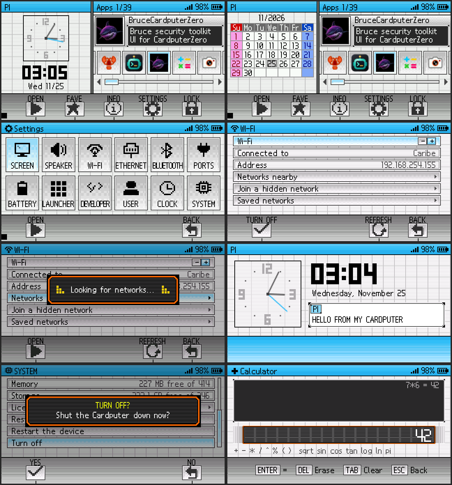
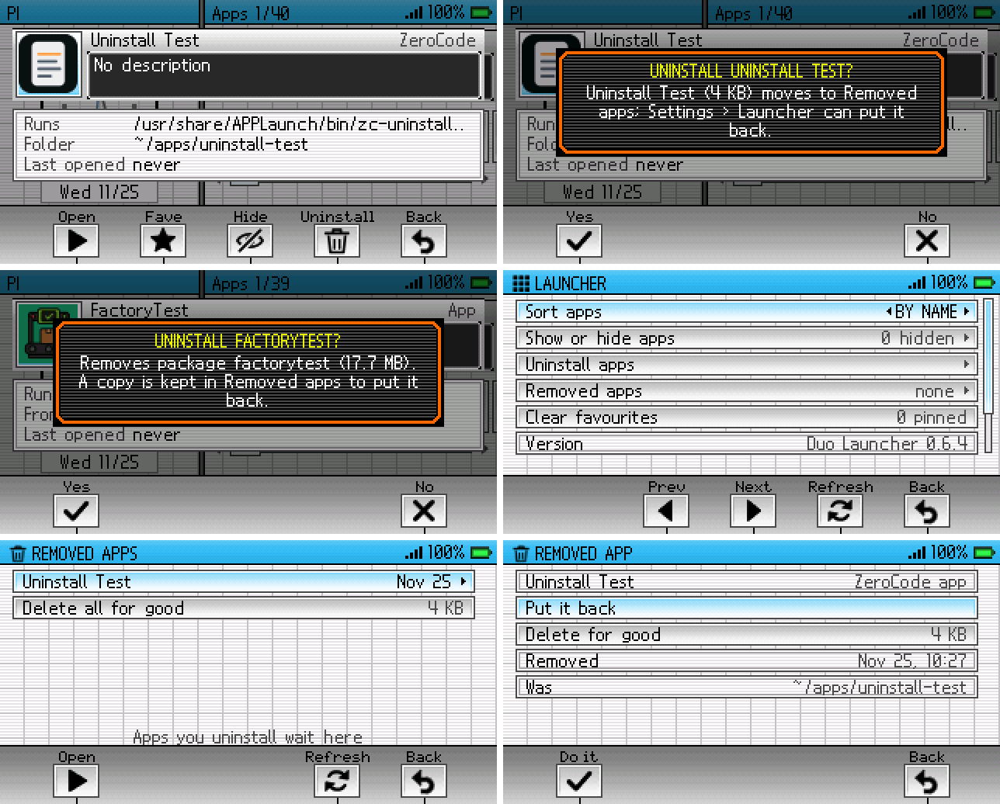

# Duo Launcher

A home screen for the M5Stack Cardputer Zero in the style of the DS system menu, built on the
textures and fonts of [ds.css](https://github.com/spiritov/ds.css) (MIT, by spiritov): the grid
paper, buttons and bars blended over a favourite colour the way its CSS does, the info header,
the orange alert with the loading squares, the striped input field, PictoChat frames, the pixel
font and the clock-digit font. The left "upper screen" shows the square clock (Tab: the calendar),
the right "touch screen" the apps. Sounds come from the Nintendo DSi UI Sounds pack (by
Helljumper; `tools/mksounds.py` converts it into `assets/sounds/`), mixed so they can overlap.

`tools/mkassets.py <ds.css-main/src/assets>` halves the textures to native pixels into `assets/`
(embedded in the binary) and pre-renders the fonts into `fontdata.go`. The clock font is under the
FontStruct Non-Commercial License (personal use).

It is the device's home screen: `device/cardputer-home` (started by `APPLaunch.service` through
`device/home-screen.conf`) runs Duo, restarts it if it crashes, and starts the stock M5Stack
launcher only when you pick Settings > Launcher > "Back to the system launcher".



## What it does

- **Home:** every app the system launcher lists (its `.desktop` folder), plus built-ins: Store,
  CLI, Python, SSH, IP Panel, Calculator, Settings. Arrows move (Up/Down jump 5), keys 4–8:
  OPEN, FAVE (pin to the front), INFO (details, hide, uninstall), SETTINGS, LOCK. Tab shows the
  calendar; hold Tab anywhere to lock and turn the screen off (sleep). Leave via Settings > Launcher.
  The chosen app's tile eases up out of the strip in your favourite colour with a soft shadow
  around it, and the one you scrolled away from eases back down.
- **Launching:** the chosen tile rises while everything else fades to white and the app's name
  fades in under it; then the app gets the screen and keyboard, and gives them back when it exits.
  CLI, Python and SSH open in Tiny Terminal (through a `$SHELL` wrapper).
- **Uninstalling apps,** with an undo: INFO > UNINSTALL, or Settings > Launcher > Uninstall apps
  (hidden apps too). Uninstalled apps wait in Settings > Launcher > Removed apps until you put
  them back or delete them for good. See [Uninstalling apps](#uninstalling-apps).
- **Settings:** Screen (brightness, dim/off timers, lock on wake), Speaker (volume, mute, menu
  sounds), Wi-Fi (on/off, scan and join, hidden networks, saved networks), Ethernet, Bluetooth
  (power, visibility, name, paired devices, pairing), Ports (Ext/Grove 5V), Battery, Launcher (sort,
  show/hide apps, uninstall apps, removed apps, favourites, updates), Developer (ADB, SSH server, last app's output), User (name, favourite
  colour, birthday, message, PIN, device name), Clock (24-hour, network time, set time, time zone,
  alarm), System (versions, memory, storage, licences, restart, power off). Admin actions ask for
  the account password on the device when they need it (kept in memory for 10 minutes); you never
  have to run sudo in a terminal.
- **Device name and /etc/hosts:** renaming the device also updates the `127.0.1.1` line of
  `/etc/hosts`. If the name is missing there (renamed some other way), sudo stalls ~10 s on every
  admin action; Settings > System then shows "Fix slow admin actions", which asks for the password
  and adds it (the old file is kept as `/etc/hosts.duo-bak`).
- **Lock screen** with an optional PIN, **alarm**, screen **dimming**, and a **calculator**.
- **Updates itself from GitHub:** Settings > Launcher > Check for updates downloads the latest
  source from this repository, builds it on the device and restarts into it (the previous
  version is kept; "Undo last update" puts it back). Needs Go at `~/.local/go`.

## Uninstalling apps



Duo works out what kind of app it is and only does what is safe for that kind:

| App | Uninstall does | Put back does |
| --- | --- | --- |
| **ZeroCode app** (`zc-<name>.desktop`, made from a folder in `~/apps`) | removes the launcher entry with the root helper `/usr/local/sbin/zc-app-root` (no password needed) and moves the folder into the bin | moves the folder back and adds the entry again |
| **Store / package app** (a dpkg package owns its `.desktop` or program) | asks for the admin password, keeps a copy of the installed package (rebuilt from dpkg's files, with its scripts and your edited settings files), then `apt-get remove` (settings kept, nothing auto-removed) | `apt-get install` of the kept copy, works offline |
| **Built-ins, Duo itself, the system launcher, essential packages** | refused: HIDE puts them away instead | |

- Before asking, it shows what goes: size, and any other package that would go with it (worked
  out from dpkg's database in a second, then double-checked with `apt-get -s` before anything
  changes; if apt disagrees, nothing is touched). It refuses if apt would remove a protected or
  essential package or install anything.
- If a package copy can't be made, it says why and asks whether to uninstall anyway.
- The bin is `~/.local/share/dslauncher/removed/<date>-<name>/` (`record.json` plus the app folder
  or the `.deb` copies). Every step is recorded first, so an uninstall or put-back cut short (power
  loss) is repaired the next time the bin is opened; a failed step is rolled back.
- Favourite pins come back with the app. Files the app keeps elsewhere (like `~/Notes`) are not
  touched.

## Build and install

```sh
GOOS=linux GOARCH=arm64 CGO_ENABLED=0 go build -trimpath -ldflags="-s -w" -o dist/ds-launcher .
cp dist/ds-launcher pkg/app
scp pkg/* pi@DEVICE:apps/duo-launcher/
ssh pi@DEVICE '~/.zerocode/kb/bin/zc-icon-svg ~/apps/duo-launcher && ~/.zerocode/kb/bin/zc-app ~/apps/duo-launcher'
```

## Testing without touching the hardware

Scripted runs draw to a file and save a PNG after each key (sounds off, no backlight changes):

```sh
CP0_FB=fb.raw DSL_CONFIG=test-config XDG_CACHE_HOME=cache DSL_SHOTS=shots \
DSL_SIM="w3,RIGHT,6,ESC,7,ENTER,ESC,OPEN:builtin:calc,ch:2,ch:+,ch:2,ENTER" ./ds-launcher
```

Steps: key names (`RIGHT`, `ENTER`, `ESC`, `TAB`, `BACKSPACE`...), `4`–`8` for the key bar,
`ch:x` to type, `wN` to wait N tenths of a second, `OPEN:<entry key>` to open an entry,
`INFO:<entry key>` for its details; end a step with `~` (`RIGHT~`) to save 10 frames of its
animation, 40 ms apart, instead of only the end. Opening an app saves the launch animation as
`launch-25` ... `launch-100`. A run ends after its last step once background work is done;
`DSL_DATA=<dir>` keeps the bin of removed apps out of your real one.
`ds-launcher --sounds out.wav` renders every sound effect to a WAV file.

Settings live in `~/.config/dslauncher/config`; the last launched app's output in
`~/.cache/dslauncher/last-app.log`.
